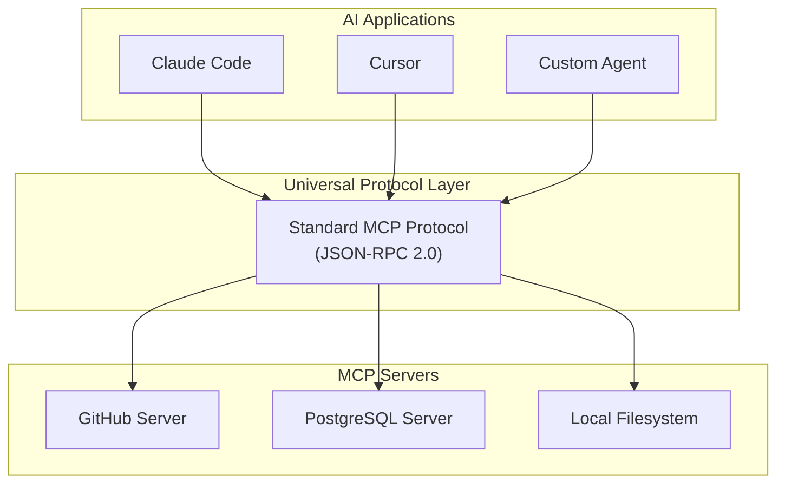
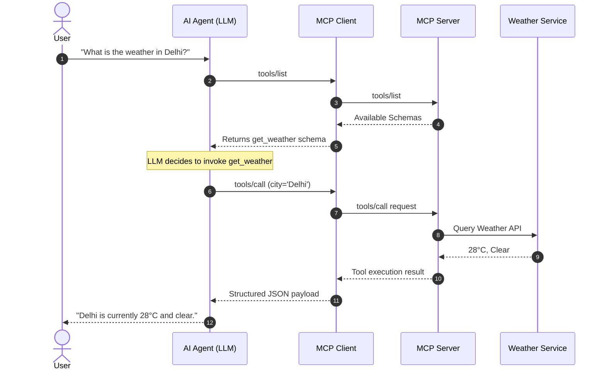
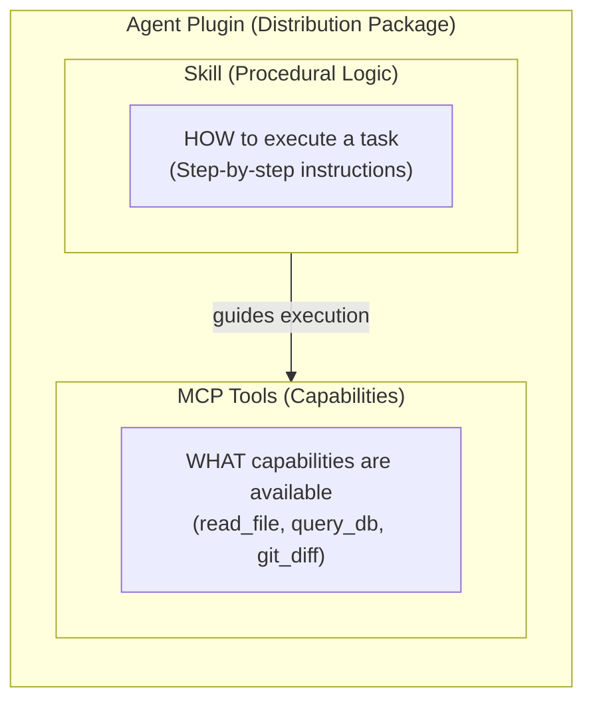
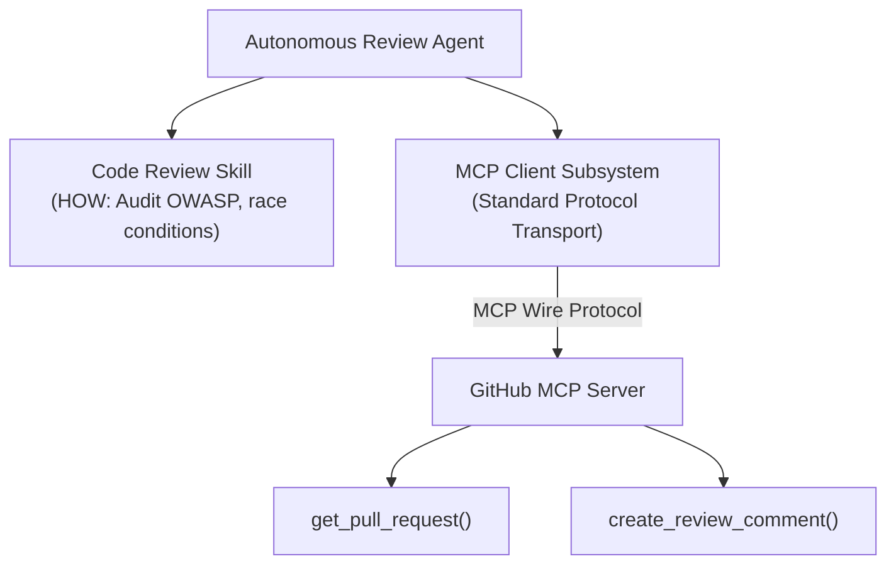
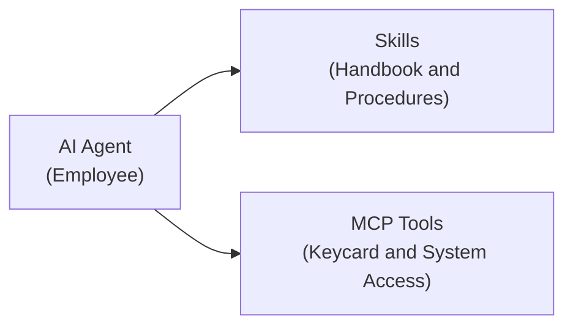

# Model Context Protocol (MCP) Explained from First Principles

If you have spent any time around **AI agents, LLMs, RAG, function calling, or generative AI systems**, you have almost certainly encountered the acronym **MCP — Model Context Protocol**.

Industry discussions quickly get bogged down in jargon:
* MCP server vs. MCP client
* Local vs. Remote transports (`stdio` vs. Streamable HTTP)
* Tool calling vs. Resources vs. Prompts
* Agent Skills vs. Agent Plugins

At first glance, it feels like another massive framework to memorize. But beneath the surface, the core thesis is remarkably elegant:

> **The Core Thesis:** MCP is an open standard that enables AI applications to securely discover and invoke external tools, context, and capabilities through a single universal protocol.

Let's break it down from first principles — without drowning in JSON-RPC specs or RFC terminology.

## 1. The Core Problem: The N × M Integration Dilemma

Imagine you are building a modern AI software engineering assistant.

To make the assistant truly useful, it cannot simply predict text in isolation. It needs to touch reality. You want it to:
* Read and modify local source code
* Query production SQL databases
* Search documentation and GitHub pull requests
* Query issue trackers like Jira or Linear
* Dispatch alerts via Slack or Discord
* Fetch live telemetry and weather data

Without a unified standard, your AI application is forced to write and maintain a custom connector for every single service:

```text
               Custom Connector Spaghetti (N × M)
               
                         ┌──► GitHub API Connector
                         ├──► Slack Webhook Client
     AI Application ─────┼──► PostgreSQL Driver
                         ├──► Jira REST Client
                         ├──► Local Filesystem API
                         └──► Linear GraphQL Client
```

Every service features a completely different authentication flow, distinct data models, varying error codes, and unique rate-limiting semantics.

Now, imagine ten different AI applications (Claude Code, Cursor, GitHub Copilot, custom internal agents) each needing to talk to those same ten services. The industry ends up writing:

```text
10 Applications × 10 Services = 100 Bespoke Connectors
```

This is the classic **N × M integration nightmare** that plagued early personal computing before USB and the early web before HTTP.

MCP replaces this fragmentation with a **hub-and-spoke model**:



Now, each service writes **one** MCP server, and every AI agent speaks **one** MCP client protocol. The complexity collapses from `N × M` down to `N + M`.

## 2. Think of MCP Like a Common Language

Consider two people who speak different native tongues:

```text
Person A (English)  ────────[ No Common Protocol ]────────  Person B (Japanese)
```

Communication is impossible without a dedicated translation pipeline. But if both parties agree on a common standard:

```text
Person A ────────[ Shared Standard: English ]──────── Person B
```

Neither person needs to know how the other person's brain processes thoughts internally. They only need to follow the grammar of the shared medium.

MCP establishes this exact contract between an AI host and an external environment:

```text
AI Application  ────────[ Standard MCP Messages ]────────  MCP Server
```

The AI application doesn't care if the server is written in Python, Rust, TypeScript, or Go. It doesn't care if the server connects to an AWS RDS instance or a flat CSV file on disk. Both sides simply exchange standardized MCP messages.

## 3. Demystifying the MCP Server

The word "server" frequently trips people up. When developers hear server, they picture a rack-mounted Linux machine in an AWS data center or a persistent Docker container.

In MCP, **an MCP server is simply any program that exposes capabilities using the MCP protocol.**

An MCP server can run:
* **Locally on your laptop**: A lightweight Python or Node.js script launched as a child process.
* **In a Docker container**: Isolated with strict filesystem or network quotas.
* **On remote cloud infrastructure**: A distributed microservice running in AWS ECS or Kubernetes behind an API gateway.

The physical execution venue is irrelevant. What matters is the interface:

> **Definition:** An MCP Server is a capability provider. It advertises what it can do (tools, resources, prompt templates) and executes those actions when requested by an authorized client.

## 4. What Does an MCP Server Actually Contain?

Suppose we write a minimal MCP server for team operations. Under the hood, it exposes Python functions:

```python
def get_weather(city: str) -> dict:
    """Fetch current temperature and conditions for a given city."""
    return weather_service.query(city)

def search_documents(query: str, max_results: int = 5) -> list[dict]:
    """Retrieve internal technical specifications from vector storage."""
    return vector_index.similarity_search(query, k=max_results)

def create_incident_ticket(title: str, severity: str) -> str:
    """File a high-priority triage ticket in Jira."""
    return jira_client.create_issue(title=title, priority=severity)
```

The MCP server packages these functions into formal MCP Tool declarations.

The AI model doesn't inspect the Python code directly. Instead, the MCP server provides a standardized JSON Schema:

```json
{
  "name": "get_weather",
  "description": "Fetch current temperature and conditions for a given city.",
  "inputSchema": {
    "type": "object",
    "properties": {
      "city": {
        "type": "string",
        "description": "The city name, e.g. San Francisco, Tokyo"
      }
    },
    "required": ["city"]
  }
}
```

The server is effectively telling the AI agent:
> *"Here is a tool named `get_weather`. If you want to use it, pass a JSON object containing a `city` string, and I will execute the rest."*

## 5. Where Does the Actual Work Happen?

A critical mental hurdle: **MCP does not replace existing APIs.**

An MCP server is typically a translation wrapper around existing infrastructure:

```text
AI Agent
   │
   │ 1. MCP Message: call_tool("search_github", {"repo": "my-org/core"})
   ▼
MCP Server (Running locally or on a gateway)
   │
   │ 2. Authenticated REST API Call (Bearer Token: ghp_xxxx)
   ▼
GitHub REST API (api.github.com)
```

The AI agent does not need to handle OAuth token refreshes, pagination edge cases, or API rate-limit headers. The MCP server encapsulates those messy implementation details and presents a clean, semantic tool interface to the agent.

## 6. MCP as a Protocol: What It Governs

A protocol is simply an agreed-upon set of rules for communication.

MCP is built on top of **JSON-RPC 2.0**. It standardizes four primary interactions:

1. **Capability Discovery (`tools/list`, `resources/list`)**: The client asks the server what functions and data streams are available.
2. **Tool Invocation (`tools/call`)**: The client instructs the server to execute a function with specific validated arguments.
3. **Data Inspection (`resources/read`)**: The client requests file contents, logs, or database records without triggering side-effect mutations.
4. **Context Injection (`prompts/get`)**: The server provides curated prompt templates designed specifically for complex domain tasks.

Because the message structure is standardized, any MCP-compliant client can interact with any MCP-compliant server out of the box.

## 7. Physical Transports: Local vs. Remote

How do these messages physically travel between the client and server? MCP separates the protocol logic from the transport layer, officially supporting two primary modes:

### Transport 1: Local MCP (`stdio`)

When both the AI application and the server run on the same physical machine:

```text
┌───────────────────────────────────────────────┐
│              Your Local Machine               │
│                                               │
│  ┌──────────────────┐   Standard Input (stdin)│
│  │  AI Application  │ ───────────────────────►│  ┌────────────────┐
│  │  (Cursor/Claude) │                         │  │   MCP Server   │
│  │                  │ ◄───────────────────────│  │ (Python Script)│
│  └──────────────────┘  Standard Output (stdout│  └────────────────┘
└───────────────────────────────────────────────┘
```

The AI application spawns the MCP server as a sub-process and communicates across standard input and output pipes (`stdin` / `stdout`).
* **Advantages:** Blazing fast latency (< 1ms), zero network overhead, no ports to open, perfectly secure against external network interception.
* **Best for:** Local filesystem operations, Git manipulation, local SQLite inspection, terminal execution.

### Transport 2: Remote MCP (Streamable HTTP / SSE)

When the MCP server runs on a centralized server or cloud environment:

```text
Local Machine                          Cloud Infrastructure (AWS / GCP)
─────────────                          ────────────────────────────────
AI Application ────[ HTTPS / SSE ]────► Load Balancer ──► MCP Server Cluster
```

Communication travels over HTTPS using Server-Sent Events (SSE) for server-to-client streaming and HTTP POST requests for client-to-server commands.
* **Advantages:** Shared team access, centralized credential management (e.g., database credentials never leave cloud VPCs), scalable compute.
* **Best for:** Enterprise data lakes, centralized CRM integrations, heavy background compute clusters.

## 8. Network Architecture in Production

In enterprise deployments, you never connect an agent directly to raw backend IP addresses:

```text
                         Client Workstation
                                 │
                                 │ HTTPS (Encrypted)
                                 ▼
                    Cloudflare / Reverse Proxy
                         (mcp.company.internal)
                                 │
                                 ▼
                      Internal Load Balancer
                                 │
                 ┌───────────────┴───────────────┐
                 ▼                               ▼
       MCP Container Instance 1        MCP Container Instance 2
                 │                               │
                 └───────────────┬───────────────┘
                                 ▼
                     Internal Enterprise DB
```

The standardized MCP protocol allows standard web infrastructure — SSL termination, IAM authorization tokens, load balancing, health monitoring, and autoscaling — to function seamlessly.

## 9. Anatomy of an MCP Client

It helps to decouple the concept of an **AI Application** from an **MCP Client**:

```text
┌────────────────────────────────────────────────────────┐
│                     AI Application                     │
│                                                        │
│  ┌────────────────────────┐  ┌──────────────────────┐  │
│  │   LLM Reasoning Core   │  │ Prompt Orchestration │  │
│  │     (Claude / GPT)     │  │     & Memory State   │  │
│  └───────────┬────────────┘  └──────────┬───────────┘  │
│              │                          │              │
│              ▼                          ▼              │
│  ┌──────────────────────────────────────────────────┐  │
│  │                 MCP Client Layer                 │  │
│  │  - Manages Subprocess Pointers & HTTP Sockets    │  │
│  │  - Parses & Validates JSON-RPC Messages          │  │
│  │  - Formats Tool Definitions into LLM Schema      │  │
│  └──────────────────────────┬───────────────────────┘  │
└─────────────────────────────┼──────────────────────────┘
                              │
                              │ MCP Wire Protocol
                              ▼
                        MCP Server(s)
```

The **AI application** handles model inference, context window management, and conversational history. The **MCP client** is the modular subsystem responsible for establishing sockets, validating schemas, dispatching calls, and receiving tool payloads.

## 10. The Tool Calling Lifecycle: Step-by-Step

Here is the exact lifecycle of an agent tool invocation under MCP:



Notice how clean the division of labor is:
* The **LLM** decides *what* to do based on descriptions.
* The **MCP Client** translates that decision into standard protocol messages.
* The **MCP Server** executes the code and accesses the outside world.

## 11. Security Boundaries: Why the AI Doesn't See Your Code

A common misconception is that connecting an LLM to an MCP server exposes your internal algorithms or proprietary database credentials to the model.

**This is entirely false.**

```text
CLIENT (AI Model View)                 SERVER (Private Host View)
──────────────────────                 ──────────────────────────
Receives:                              Keeps Completely Private:
• Tool name ("query_db")               • SQL Connection Strings & Passwords
• Parameter Schema (table, filters)    • Internal Query Logic & Sanitization
• Structured JSON Output               • VPC Firewalls & Database Drivers
```

The AI model only receives the public interface (metadata, parameter names, type constraints) and the final output payload. Your private database connection strings, API tokens, and business logic remain strictly isolated inside the server process.

## 12. De-confusing the Ecosystem: MCP vs. Skills vs. Plugins

One of the most persistent confusions in modern agent development is distinguishing between **MCP**, **Skills**, and **Plugins**. They operate at completely different layers of the agent hierarchy:



### The Breakdown:
* **MCP (The Capabilities / Tools)**: Defines *what* the agent can physically do. Exposes capabilities like `read_file()`, `run_query()`, or `create_pull_request()`.
* **Skill (The Instructions / Knowledge)**: Defines *how* the agent should execute a task. A markdown instruction file (`SKILL.md`) that guides reasoning: *"Step 1: Inspect diffs. Step 2: Check for race conditions. Step 3: Flag memory leaks."*
* **Plugin (The Package)**: The distribution vehicle that binds Skills and MCP server configurations together into an installable module.

## 13. End-to-End Walkthrough: Building an Autonomous Code Reviewer

To see how Skills and MCP work in unison, consider an automated **GitHub Code Review Assistant**:



1. **The Skill** directs the workflow:
   ```markdown
   # Code Review Workflow
   1. Fetch the pull request diff using `get_pull_request`.
   2. Audit modified lines for SQL injection or unescaped HTML.
   3. If vulnerabilities exist, post inline comments via `create_review_comment`.
   ```
2. **The MCP Server** provides the muscle:
   * It exposes authenticated primitives: `get_pull_request(pr_id)`, `create_review_comment(pr_id, file, line, body)`.
3. **The Result**: The agent possesses both the strategic plan (Skill) and the authorized tools (MCP) required to complete the mission autonomously.

## 14. Architecture Comparison: Traditional REST vs. MCP

To appreciate the architectural shift, compare traditional application development with agentic protocol integration:

```text
TRADITIONAL INTEGRATION ARCHITECTURE
Application Code ──[ Bespoke REST Client ]──► Target Service (GitHub / Slack)
* Hard-coded endpoints
* Custom token parsing in app logic
* Breaking API changes require manual code refactoring

AGENTIC PROTOCOL ARCHITECTURE (MCP)
LLM Agent ──[ MCP Protocol ]──► MCP Server ──[ REST / SDK ]──► Target Service
* Dynamic tool discovery via standard schema
* LLM reasoner selects tools based on semantic descriptions
* Server handles API updates; agent remains completely decoupled
```

## 15. The Employee Mental Model

If you ever find yourself getting confused, fall back on this simple organizational analogy:

Think of an AI Agent as a **newly hired employee**:
* **The Skill is the Employee Handbook**: It teaches the employee standard operating procedures, policies, and analytical frameworks.
* **MCP is the Keycard & System Access**: It grants the employee physical badge access to the server room, database credentials, and company software tools.



A brilliant employee with no badge access cannot get anything done. An untrained employee with full database credentials will cause havoc. True agency requires both **clear procedural guidance (Skills)** and **standardized, audited capability access (MCP)**.

## 16. Beyond the Basics: Advanced Horizons

Once you understand the fundamentals, modern MCP implementations unlock sophisticated engineering patterns:

* **Stateless vs. Stateful Sessions**: Streamable HTTP allows servers to maintain ephemeral conversational state or scale horizontally across stateless worker clusters.
* **Sampling (`roots/list` & `sampling/createMessage`)**: Allows an MCP server to request LLM generations back from the client host, turning servers into autonomous multi-agent co-processors.
* **Dynamic Resource Subscriptions**: Clients can subscribe to live telemetry feeds, triggering agent actions whenever log metrics drift or error budgets deplete.
* **Human-in-the-Loop Approval Gates**: Critical MCP tool calls (such as `drop_table` or `wire_funds`) can trigger interactive authorization prompts in the host client before execution.

MCP transforms generative AI from an isolated text predictor into an interconnected, capable operating system. By standardizing the boundary between language models and physical systems, it provides the foundation upon which real-world agentic software is built.
